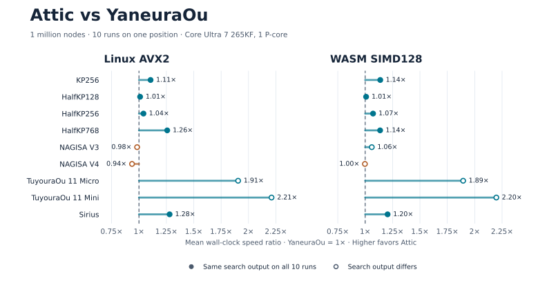

# パフォーマンス

## Linux AVX2 と WASM SIMD128

Intel Core Ultra 7 265KF の P コア（論理 CPU 6）に固定し、Threads 1、置換表 16 MiB、定跡無効で計測した。
同じ局面（fixture 565）を各条件で10回探索し、毎回 `usinewgame` と `isready` を送った。
`go nodes 1000000` から `bestmove` までの実時間を計り、評価ファイルのロード時間は計時区間から外した。



表の値は **Attic / やねうら王の平均秒数（やねうら王の時間 ÷ Attic の時間）**。

| 評価関数 | Linux AVX2 | WASM SIMD128 |
|---|---:|---:|
| KP256 | 0.465 / 0.514（1.11×） | 0.881 / 1.003（1.14×） |
| HalfKP128 | 0.446 / 0.451（1.01×） | 0.777 / 0.784（1.01×） |
| HalfKP256 | 0.503 / 0.523（1.04×） | 0.927 / 0.994（1.07×） |
| HalfKP768 | 0.611 / 0.769（1.26×） | 1.182 / 1.343（1.14×） |
| NAGISA V3 | 0.680 / 0.668（0.98×） | 1.264 / 1.340（1.06×） |
| NAGISA V4 | 1.012 / 0.948（0.94×） | 1.919 / 1.914（1.00×） |
| つようら王11 Micro | 0.778 / 1.483（1.91×） | 1.422 / 2.695（1.89×） |
| つようら王11 Mini | 1.186 / 2.621（2.21×） | 2.153 / 4.732（2.20×） |
| Sirius | 1.323 / 1.692（1.28×） | 2.223 / 2.678（1.20×） |

## ビルド条件

計測に使った局面です。

```text
sfen +B4g1nl/2g2k3/ppnppsbpp/4r1p2/5p2P/3S2P2/PPPPPP1P1/2GS2S2/LN2KG1NL w Lrp 32
```

- Attic Linux は `e6a5dfe` と同じソースツリー（`7953ccf`）、Rust release、`target-cpu=x86-64-v3`、`ref_check_time`。
- Attic WASM は同じベースに実験版の WASI ホスト対応と SIMD128 評価カーネルを重ねた単一スレッドビルド。Node.js 26.5.0 で実行。
- やねうら王は V9.96 系。NAGISA とつようら王は対応する進行度付きビルド、Sirius は評価関数を追加したパッチ版。WASM は Emscripten SIMD128 を同じ Node.js で実行。
- `FV_SCALE` は両エンジンで共通。つようら王は24、NAGISA は28、Sirius は26。

## 探索結果の照合

時間、NPS、hashfull を除く `info depth` と `bestmove` を比較した。探索出力が異なる行の速度比には探索内容の違いが含まれる。

| 評価関数 | 環境 | 最終ノード数 | bestmove | 探索出力全体 |
|---|---|---:|---:|---:|
| KP256 | Linux AVX2 | 10/10 | 10/10 | 10/10 |
| KP256 | WASM SIMD128 | 10/10 | 10/10 | 10/10 |
| HalfKP128 | Linux AVX2 | 10/10 | 10/10 | 10/10 |
| HalfKP128 | WASM SIMD128 | 10/10 | 10/10 | 10/10 |
| HalfKP256 | Linux AVX2 | 10/10 | 10/10 | 10/10 |
| HalfKP256 | WASM SIMD128 | 10/10 | 10/10 | 10/10 |
| HalfKP768 | Linux AVX2 | 10/10 | 10/10 | 10/10 |
| HalfKP768 | WASM SIMD128 | 10/10 | 10/10 | 10/10 |
| NAGISA V3 | Linux AVX2 | 0/10 | 10/10 | 0/10 |
| NAGISA V3 | WASM SIMD128 | 0/10 | 8/10 | 0/10 |
| NAGISA V4 | Linux AVX2 | 0/10 | 10/10 | 0/10 |
| NAGISA V4 | WASM SIMD128 | 0/10 | 4/10 | 0/10 |
| つようら王11 Micro | Linux AVX2 | 0/10 | 10/10 | 0/10 |
| つようら王11 Micro | WASM SIMD128 | 0/10 | 9/10 | 0/10 |
| つようら王11 Mini | Linux AVX2 | 0/10 | 0/10 | 0/10 |
| つようら王11 Mini | WASM SIMD128 | 0/10 | 1/10 | 0/10 |
| Sirius | Linux AVX2 | 10/10 | 10/10 | 10/10 |
| Sirius | WASM SIMD128 | 10/10 | 10/10 | 10/10 |

[平均と標準偏差（CSV）](benchmark/results.csv)

## Attic 内の計測

`bench [ttSizeMB] [threads] [limit] [default|current|<fenFile>] [limitType]` は固定条件で NPS を計測します。引数はすべて省略でき、既定値は置換表 1024 MB、1 スレッド、`limit` 15000、`limitType` は `movetime` です。

### Sirius の差分更新

**速度**は、[互換性の検証](yaneuraou-compatibility.md#sfnn_halfkahm2_threat_1024_15_64_8gp)で使った 584 局面（depth 9、Threads 1）を、このマシンの P コア 1 つに固定して 3 回測ると、644,520〜693,304 nps（約 674 万ノード）でした。測定中、このマシンでは他のプロセスも動いていました。差分更新を使わず毎手作り直すビルドは、同じ条件で 132,875 と 187,754 nps で、ばらつきが大きく、比としては使えません。この計測の比較対象は Attic の全計算ビルドです。

## V9.80 時点の測定

**この節の値は V9.80 に基準を置いていた時点の Attic と YaneuraOu V9.80 で測ったもの**で、V9.96 では測り直していません。V9.96 の追従で探索・置換表・履歴表が変わっているので、速度比は変わっている可能性があります。

YaneuraOu を 1 とした比です。YaneuraOu 側も同じ評価関数で動かしています。表は、ビルドの方法ごとに測ったうち速い方の値です。1 スレッドで、1 局面 10 万ノード × 128 局面を交互に測定しました。

| ビルド                                     | コマンド                | 速度比 |
| ------------------------------------------ | ----------------------- | ------ |
| `nnue_kp_256x2_32_32`                      | `cargo xtask build-pgo` | 1.053  |
| `nnue_halfkp_256x2_32_32`                  | `cargo xtask build-pgo` | 1.022  |
| `nnue_halfkp_128x2_32_32`                  | `cargo xtask build-pgo` | 0.998  |
| `nnue_halfkp_768x2_16_64`                  | `cargo xtask build-pgo` | 1.008  |
| `sfnn_halfkahm2_1024_15_64_progress8kpabs` | `cargo xtask build-pgo` | 0.424  |
| `sfnn_halfkahm2_2304_15_64_progress8ek`    | `cargo xtask build-pgo` | 0.416  |

SFNN の 2 つは、YaneuraOu 側が shielune 版です。遅い原因は調べていません。AVX-512 のカーネルと、表にない評価関数の速度は測っていません。
